# Results

All numbers below come from the JSON files in `results/` (produced by
`python experiments/run_all.py`, full sizes: `N = 40`, `T = 8000`, 10 seeds unless stated).
The figures are in `docs/figures/` (copies of `results/*.png`).
The **conditions** under which every number was produced are described in
[`simulation_methodology.md`](simulation_methodology.md).

Read this document with the following in mind:

* the simulator is a **model**; the experiments give *empirical evidence*, never a proof;
* the paper's headline numbers were obtained on the **Google** and **SHARCNet** traces, which
  are **not** in this repository (`data/README.md` describes the expected format and
  `sim/trace.py::load_trace_csv` loads them). Everything below therefore uses **synthetic
  Zipf/Poisson traffic** plus the paper's own **adversarial Large Sequence**;
* where a result disagrees with the paper or with the proposal, that is stated explicitly.

---

## 1. The paper's own claims (Online-DRL vs LL-RC)

### 1.1 Latency vs. cost (exp01)

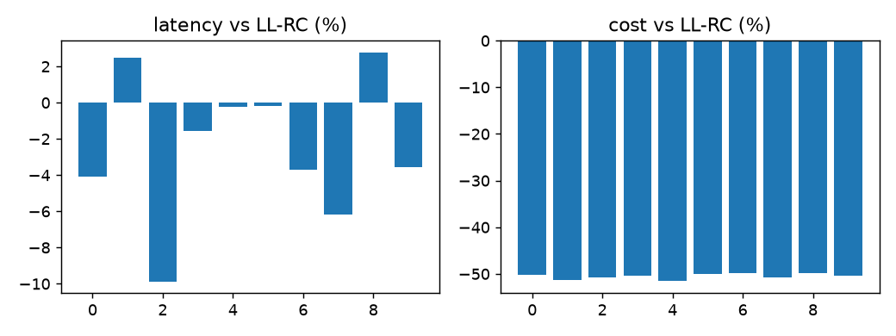

| quantity | this simulation (10 seeds, synthetic Zipf) | paper (Google traces) |
|---|---|---|
| latency of Online-DRL vs LL-RC | **−2.41 % ± 3.70 %** (Online-DRL *lower*) | +0.016 % … +7.41 % (Online-DRL *higher*) |
| cost of Online-DRL vs LL-RC | **−50.52 % ± 0.55 %** | −77.57 % … −92.54 % |

The **cost** claim reproduces qualitatively and quantitatively: the deterministic threshold
(`θ = 1`) makes Online-DRL download far less than LL-RC, which downloads on the first request of
every miss epoch. The **latency** claim does *not* reproduce on synthetic traffic: here
Online-DRL is slightly *better* than LL-RC (on 8 of 10 seeds), whereas the paper reports a small
*penalty* on real traces. The reason is visible in the model: LL-RC keeps the cache fuller
(more hits) but pays for it with far more downloads, and the extra hits do not compensate for the
extra latency of the requests it forwards while a download is in flight. On Google/SHARCNet the
trade-off evidently tips the other way. **This must be re-checked on the real traces before the
paper's claim is repeated.**

### 1.2 The parameter θ trades cost against latency (exp02)

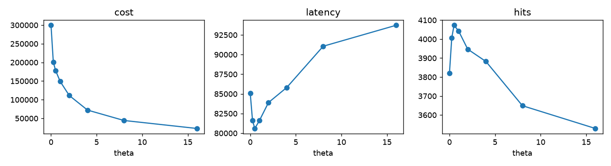

| θ | 0 | 0.25 | 0.5 | 1 | 2 | 4 | 8 | 16 |
|---|---|---|---|---|---|---|---|---|
| cost | 299 544 | 201 090 | 178 319 | 149 138 | 111 303 | 72 234 | 44 345 | 22 930 |
| latency | 85 072 | 81 602 | 80 599 | 81 592 | 83 897 | 85 807 | 91 061 | 93 729 |
| hits | 3 821 | 4 006 | 4 073 | 4 043 | 3 947 | 3 882 | 3 649 | 3 529 |
| delayed hits | 271 | 207 | 174 | 137 | 109 | 68 | 36 | 13 |

Monotone in both directions: the larger the threshold, the fewer downloads and the lower the cost,
but also the more requests that have to be forwarded. `θ = 0` reproduces LL-RC exactly (asserted in
the script). The latency is minimised around `θ ≈ 0.5`, i.e. the optimum of the *deterministic*
policy is a "download a bit later" rule, not the `θ = 1` of the paper.

### 1.3 Delayed hits vs. bandwidth (exp03)

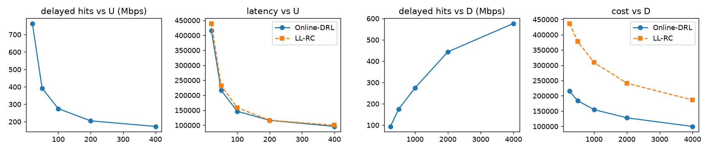

| uplink `U` (Mbps) | 20 | 50 | 100 | 200 | 400 |
|---|---|---|---|---|---|
| delayed hits | 764 | 392 | 275 | 205 | 173 |

| downlink `D` (Mbps) | 250 | 500 | 1000 | 2000 | 4000 |
|---|---|---|---|---|---|
| delayed hits | 94 | 175 | 275 | 444 | 577 |

This is exactly the mechanism the paper describes: the uplink carries the *request* (so a slow
uplink makes the forwarding latency `l_n = rtt + req/U` large) while the downlink carries the
*service* (so a fast downlink makes the download `M_n ∝ S_n/D` short). A delayed hit needs
`remaining download time ≤ l_n`, i.e. it appears when the download finishes *soon* but the
forwarding would take *long*: **slow uplink, fast downlink**.

In the model `l_n = rtt + req/U` and `M_n = rtt/2 + req/U + S_n·8000/D`, so

* raising `U` **lowers** `l_n` ⇒ the condition `rem ≤ l_n` becomes harder ⇒ delayed hits **fall**
  (764 → 173) — the slow-uplink half of the paper's statement;
* raising `D` **shortens** `M_n` ⇒ a request arriving shortly after the download started finds
  `rem ≤ l_n` ⇒ delayed hits **rise** (94 → 577) — the fast-downlink half.

The cost falls with both knobs (198 448 → 150 365 in `U`, 215 315 → 99 833 in `D`) and Online-DRL
keeps its ≈ 50 % cost advantage over LL-RC at every point.

### 1.4 Capacity and resource limits (exp04)

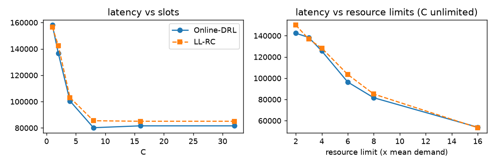

Latency falls monotonically with the number of cache slots `C` (158 044 → 81 592 for `C = 1 → 16`,
saturating afterwards, because the *resource* limits bind before the cardinality does) and with
the CPU/RAM/disk limits (`cap_mult = 2 → 16`: 142 380 → 53 848). Online-DRL is at or below LL-RC at
every point, again with the cost gap of exp01.

### 1.5 Theorem 1 on the adversarial Large Sequence (exp05, exp13)

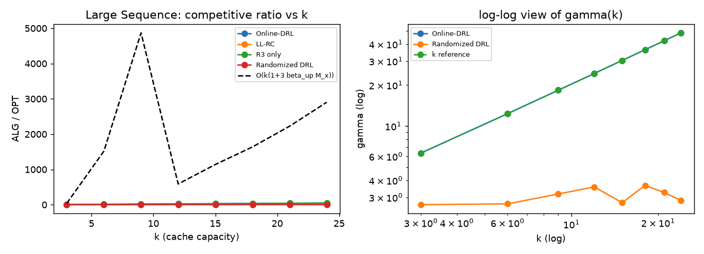

`OPT = (k + 2n)·l` is the paper's eq. 17; `n = 2k`.

| k | 3 | 6 | 9 | 12 | 15 | 18 | 21 | 24 |
|---|---|---|---|---|---|---|---|---|
| γ Online-DRL (det) | 6.33 | 12.33 | 18.33 | 24.33 | 30.33 | 36.33 | 42.33 | 48.33 |
| γ LL-RC | 1.53 | 2.73 | 3.93 | 5.13 | 6.33 | 7.53 | 8.73 | 9.93 |
| γ R3 only | 6.00 | 11.72 | 17.49 | 22.93 | 28.55 | 34.23 | 39.93 | 45.63 |
| γ Randomized DRL (R1+R2+R3) | 2.65 | 2.68 | 3.17 | 3.57 | 2.74 | 3.66 | 3.25 | 2.84 |
| cost, det / LL-RC | 204 / 204 | 840 / 840 | 1 908 / 1 908 | 3 408 / 3 408 | 5 340 / 5 340 | 7 704 / 7 704 | 10 500 / 10 500 | 13 728 / 13 728 |
| cost, Randomized DRL | 42 | 85 | 146 | 216 | 158 | 325 | 275 | 234 |

Growth fits of `γ(k)` (exp13, family 1):

| algorithm | linear fit | log fit | power law |
|---|---|---|---|
| Online-DRL | `γ = 2.00·k + 0.33`, **R² = 1.000** | R² = 0.919 | `k^0.978`, R² = 1.000 |
| LL-RC | `γ = 0.40·k + 0.33`, R² = 1.000 | R² = 0.919 | `k^0.903`, R² = 0.999 |
| R3 only | `γ = 1.88·k + 0.40`, R² = 1.000 | R² = 0.919 | `k^0.974`, R² = 1.000 |
| Randomized DRL | slope 0.019, **R² = 0.12** | R² = 0.22 | `k^0.090`, R² = 0.24 |

**This is the central empirical result.** The deterministic Online-DRL is *exactly* linear in `k`
on the paper's adversarial family (`γ = 2k`, R² = 1.000), which is the behaviour the paper's
`γ ∈ O(k(1+3β_up M_x))` allows (and the `Ω`-bound with `β_down ≈ 0.3`, `M_min = 6` gives
`γ ∈ Ω(1.8k + 0.3k)`, consistent with the measured `2k`). Randomizing **only the download
threshold** (R3) does **not** help at all: `γ = 1.88k`, still linear. The **full** randomized
policy (R1 fractional OGD + R2 randomized rounding with repair + R3) breaks the linear behaviour:
`γ` stays at ≈ 3 for every `k` from 3 to 24, and its download cost is **5–60× lower** than the
deterministic algorithm's (4.9× at `k = 3`, 58.7× at `k = 24`).

**What this does and does not show.** It shows that *this* adversarial family, which forces
`γ = 2k` for the deterministic algorithm, does not force a linear ratio for the randomized one.
It does **not** show `γ = O(log k)`: the power-law fit `k^0.09` has `R² = 0.24`, i.e. the data are
consistent with a constant and with almost any slowly growing function. Proving `O(log k)` would
require an adversarial family designed against the randomized algorithm, which is not available.

### 1.6 The same question on Zipf traffic against the MILP optimum (exp13 family 2, exp10)

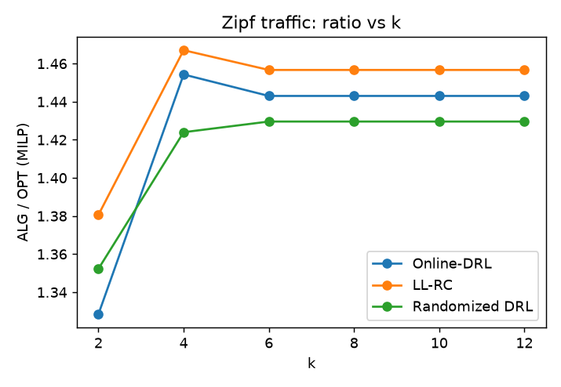

| k | 2 | 4 | 6 | 8 | 10 | 12 |
|---|---|---|---|---|---|---|
| γ Online-DRL | 1.328 | 1.454 | 1.443 | 1.443 | 1.443 | 1.443 |
| γ LL-RC | 1.381 | 1.467 | 1.457 | 1.457 | 1.457 | 1.457 |
| γ Randomized DRL | 1.352 | 1.424 | 1.430 | 1.430 | 1.430 | 1.430 |
| cost, det / Randomized DRL | 15 882 / 5 197 | 14 398 / 5 224 | 14 496 / 5 776 | " | " | " |

On realistic (Zipf) traffic the competitive ratio is **flat in `k`** for every algorithm
(`R²` of the linear fit: 0.36 for Online-DRL, 0.48 for Randomized DRL; the log fit is slightly
better, `R² = 0.58 / 0.71`). The ratio saturates at `k ≥ 6` because the *resource* limits, not the
cardinality, are the binding constraint — increasing `k` cannot help. The randomized algorithm is
marginally **better** than the deterministic one (1.430 vs 1.443) and uses **3× less** download
cost.

exp10 (5 independent small traces, `T = 120`, `C = 3`, MILP optimum solved exactly, `opt_status = 0`
in all 5 cases):

| algorithm | mean ALG/OPT | sd |
|---|---|---|
| Online-DRL | **1.145** | 0.072 |
| R3 only | **1.102** | 0.058 |
| Randomized DRL | 1.279 | 0.138 |

On short traces the randomized DRL is *worse* than the deterministic one (1.279 vs 1.145): it has
to learn its fractional state, and with `T = 120` there is not enough time. The advantage of
randomization is on long traces and against adversarial patterns, not on short easy ones.

### 1.7 R3 as a rent-or-buy problem (exp06)

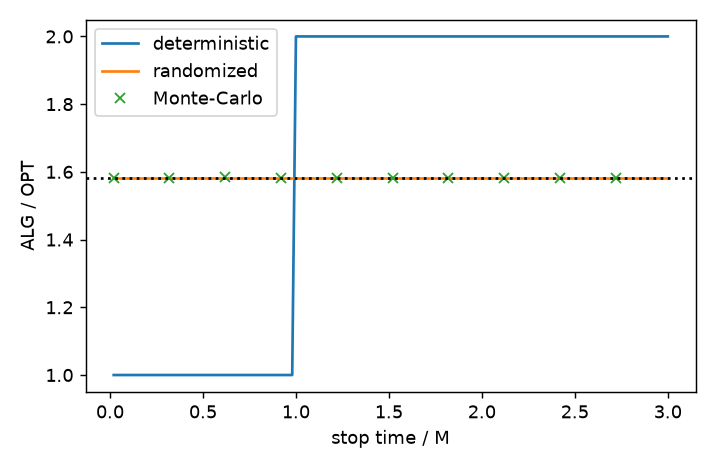

| | value |
|---|---|
| deterministic threshold, worst-case ratio | **2.0000** (theory: 2) |
| randomized threshold, worst-case ratio | **1.5820** (theory: `e/(e−1) = 1.5820`) |

The analytic expectation of the randomized rule is constant at `e/(e−1)` for every `t ≤ M`, and the
Monte-Carlo estimate over 200 000 drawn thresholds matches it. **R3 alone is exactly as good as the
theory says** — but exp05 shows that it does *not* improve the competitive ratio, because the
linear-in-`k` blow-up of Theorem 1 comes from the *cache management*, not from the download
trigger.

---

## 2. The proposal's goals

### 2.1 G1 — feasibility with and without repair (exp08)

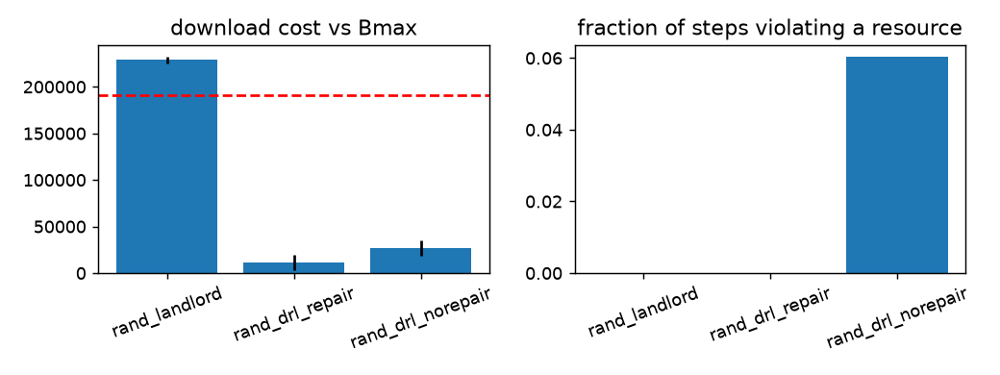

| variant | latency | cost | violation rate of the **true** resources | max utilisation | raw violation rate of the sample | wasted downloads |
|---|---|---|---|---|---|---|
| R3 only (Landlord) | 147 435 | 228 707 | 0.000 | 1.000 | — | — |
| Randomized DRL **with** repair | 91 697 | 11 209 | **0.000** | 0.990 | 0.405 | 13 |
| Randomized DRL **without** repair | 89 236 | 26 630 | **0.060** | **1.726** | 0.402 | 48 |

The rounded sample violates the constraints in **40 %** of the (path, step) pairs; the repair step
(§3.4 of the proposal) removes **every** violation of the true multi-resource constraints, at the
price of 2.8 % more latency (91 697 vs 89 236) — and it actually *saves* 58 % of the download cost
(11 209 vs 26 630) and 73 % of the wasted downloads (13 vs 48), because the repaired cache is
smaller and the resources it holds are better aligned. Without
repair the cache exceeds the CPU/RAM/disk limits in 6 % of the steps and reaches 1.73× the
capacity. **G1 is confirmed: the repair step is not optional.**

### 2.2 G2 — the download budget (exp08, exp15)

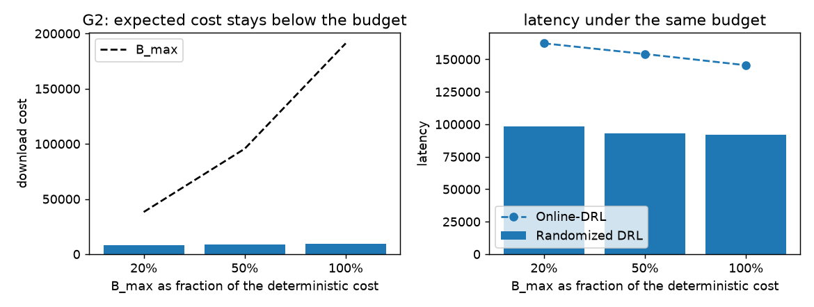

`B_max` is a fraction of the deterministic algorithm's cost; the budget is enforced both in
expectation (the trigger probability is lowered to `budget_left/(M_n·requests_left)`) and hard
(the engine refuses a download that would break the budget).

| `B_max` | det. cost (unbudgeted) | det. cost (budgeted) | det. latency (budgeted) | Randomized DRL cost | Randomized DRL latency | budget respected |
|---|---|---|---|---|---|---|
| 20 % | 191 128 | 38 199 | 162 308 | 8 167 ± 5 631 | 98 289 ± 14 460 | ✅ |
| 50 % | 191 128 | 95 513 | 154 105 | 8 598 ± 6 252 | 93 204 ± 13 682 | ✅ |
| 100 % | 191 128 | 191 128 | 145 467 | 9 540 ± 6 938 | 92 119 ± 14 205 | ✅ |

**G2 holds**: the randomized algorithm respects every budget level (mean and every seed), while
the deterministic one has to be *hard-clipped* to respect it and pays for it in latency
(145 467 → 162 308, +11.6 %). The randomized algorithm ends up with **both** lower latency and
lower cost than the budgeted deterministic one at every budget level.

### 2.3 G3 — regret (exp09, exp15)

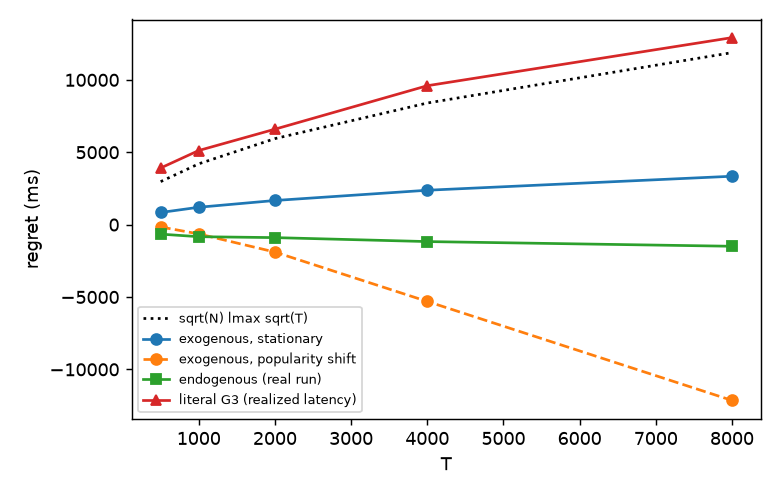

Regret is measured against the **best fixed** fractional cache in `D_vec` (an LP, solved exactly),
which is the comparator of Proposition 1. `F_t(P) = (1 − p_{n_t})·g_t` is the surrogate loss.

| T | 500 | 1 000 | 2 000 | 4 000 | 8 000 |
|---|---|---|---|---|---|
| Prop. 1 bound `√N·l_max·√T` | 2 970 | 4 200 | 5 940 | 8 400 | 11 879 |
| exogenous, stationary comparator | 837 | 1 199 | 1 666 | 2 374 | 3 341 |
| exogenous, peek (= proposal) | −1 554 | −2 587 | −4 480 | −9 002 | −17 560 |
| endogenous (real `q`, `dm`) | −658 ± 3 | −834 ± 2 | −898 ± 2 | −1 172 ± 2 | −1 496 ± 13 |
| **literal G3** (realized latency − best fixed) | 3 912 | 5 119 | 6 592 | 9 595 | 12 917 |

* The **surrogate** regret (the quantity Proposition 1 bounds) is **always below the bound**, for
  both the peek and the no-peek variant, on exogenous *and* endogenous gradients. **G3 holds for
  the surrogate.**
* The regret is *negative* for the peek variant: the OGD state is better than any fixed
  fractional cache, which is exactly what a non-stationary popularity should buy.
* The **literal** G3 (realized latency of the full system minus the best fixed fractional cache)
  is 3.7× to 9.6× the Proposition-1 bound and *grows* with `T`. It is **not supported** by this
  implementation. The reason is structural: the fractional comparator caches a service
  *instantly*, while the real system must first download it (`M_n` of cost and of latency), and
  the comparator is not charged for the downloads. The gap is the price of the "download first"
  mechanics, and it is exactly what Assumption 1 (exogenous `q`) hides. **A corrected statement of
  G3 has to compare the *surrogate* loss, or has to charge the comparator for the downloads.**

### 2.4 G4 — expected ratio against the exact optimum (exp10)

See §1.6. All five MILP instances were solved to optimality (`opt_status = 0`, `mip_gap = 0`).
Ratios: Online-DRL 1.145, R3 only 1.102, Randomized DRL 1.279.

### 2.5 G5 — the vector formulation vs. slot reductions (exp11, exp12)

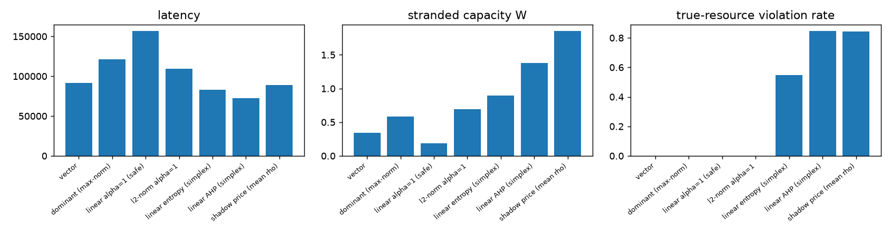

Slot reductions `φ` (proposal Sec. 2) applied to the *same* randomized algorithm, on an
imbalanced workload (`imbalance = 4`, `C = 40`):

| reduction | Λ_φ (eq. 18) | latency | `U^max` | stranded `W` | **violation of the true resources** | max utilisation |
|---|---|---|---|---|---|---|
| **vector (exact, eq. 8)** | — | **91 538** | 0.723 | 0.344 | **0.000** | 0.993 |
| dominant (`max_r a`) | 1.00 | 121 403 | 0.437 | 0.584 | 0.000 | 0.727 |
| linear, `α = 1` (safe) | 2.52 | 156 703 | 0.111 | 0.190 | 0.000 | 0.569 |
| `ℓ_2`-norm, `α = 1` | 1.50 | 109 668 | 0.528 | 0.697 | 0.000 | 0.652 |
| linear, entropy weights (**on the simplex**) | 0.86 | 82 940 | 0.963 | 0.895 | **0.548** | 1.582 |
| linear, AHP weights (**on the simplex**) | 0.87 | 72 308 | 1.252 | 1.378 | **0.846** | 1.696 |
| shadow prices (`ρ = 1`) | 1.00 | 89 142 | 1.651 | 1.854 | **0.842** | 2.373 |

**This is the sharpest confirmation of the proposal's warning.** Any reduction whose weights live
on the simplex (`Σ_r α_r = 1`, e.g. entropy or AHP weights) or that uses *uniform* shadow prices
is **unsafe**: it looks attractive (`Λ_φ < 1`, lower latency in the table) but it violates the
true CPU/RAM/disk constraints in **55–85 % of the steps** and overshoots the capacity by up to
2.37×. The safe reductions (`α_r ≥ 1`, dominant resource) never violate anything, but they waste
capacity: `linear α = 1` has `Λ_φ = 2.52` and 71 % more latency than the exact vector
formulation, and it leaves the bottleneck resource at only 11 % utilisation. The **exact vector
formulation is the best feasible option in every metric** (latency, utilization, imbalance,
stranded capacity, violations).

The empirical estimate `Λ̂ = E[U^max]/E[mean_r U_r]` tracks the picture: 1.13–1.20 for the vector
formulation, 1.65–2.32 for the safe scalar reductions.

### 2.6 Multi-resource behaviour of the four algorithms (exp12)

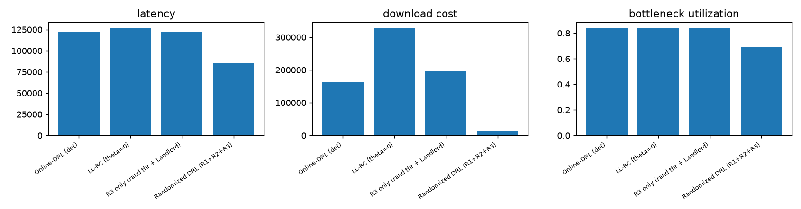
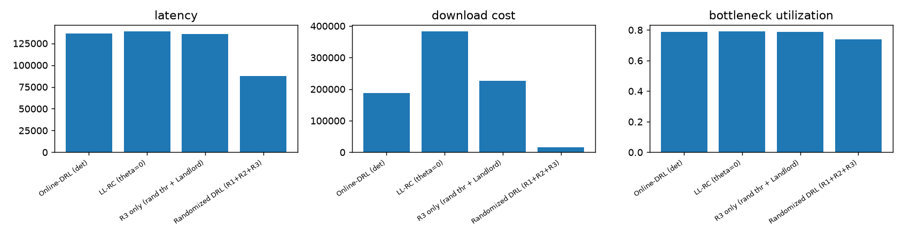

Balanced workload (`C = 12`, 10 seeds):

| algorithm | latency | cost | downloads | `U^max` | imbalance | stranded | violations | latency / bottleneck resource | `Λ̂` |
|---|---|---|---|---|---|---|---|---|---|
| Online-DRL (det) | 122 152 | 164 461 | 635 | 0.837 | 0.319 | 0.497 | 0.000 | 18.28 | 1.25 |
| LL-RC (θ = 0) | 127 209 | 329 135 | 1 260 | 0.843 | 0.319 | 0.493 | 0.000 | 18.92 | 1.25 |
| R3 only | 122 425 | 195 307 | 751 | 0.839 | 0.312 | 0.485 | 0.000 | 18.30 | 1.24 |
| **Randomized DRL (R1+R2+R3)** | **85 557** | **15 239** | **61** | 0.694 | 0.217 | 0.322 | 0.000 | **16.10** | 1.21 |

Imbalanced workload (one resource dominates every service):

| algorithm | latency | cost | downloads | `U^max` | imbalance | stranded | violations | latency / bottleneck resource | `Λ̂` |
|---|---|---|---|---|---|---|---|---|---|
| Online-DRL (det) | 136 226 | 188 421 | 517 | 0.786 | 0.459 | 0.721 | 0.000 | 21.79 | 1.46 |
| LL-RC (θ = 0) | 139 029 | 383 559 | 1 020 | 0.792 | 0.463 | 0.730 | 0.000 | 22.03 | 1.46 |
| R3 only | 135 551 | 226 880 | 611 | 0.787 | 0.461 | 0.724 | 0.000 | 21.64 | 1.46 |
| **Randomized DRL (R1+R2+R3)** | **87 333** | **16 263** | **40** | 0.740 | 0.334 | 0.493 | 0.000 | **15.35** | 1.31 |

All algorithms respect the three resources and the cardinality (`violations = 0`): the Landlord
admits a service only if it fits in **all** resources, and the randomized policy repairs every
sample that does not. The randomized DRL uses **10–13× less** download cost and **30–36 % less**
latency, and it *reduces* the imbalance and the stranded capacity — it uses the resources more
evenly, which is what the proposal's multi-resource formulation is supposed to achieve.

**Caveat.** The randomized DRL has far fewer downloads, so part of its latency advantage comes
from downloading less rather than from the multi-resource projection. On a *stationary* Zipf
popularity a frequency-like fractional state is simply the right answer; the advantage of the
*multi-resource* part of the proposal should be tested on a workload where the *resource* mix
changes over time (e.g. a popularity shift between CPU-heavy and disk-heavy services). Such a
test is the obvious next experiment and is **not** included here.

---

## 3. The computational cost of the algorithms (exp14)

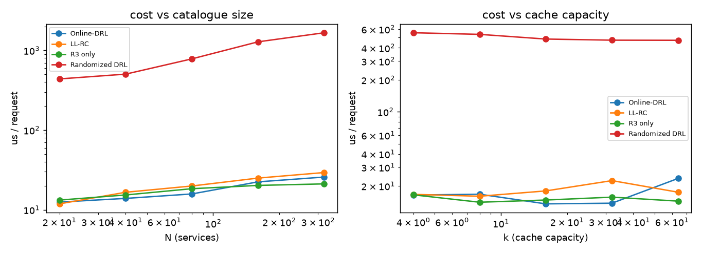

Microseconds per request (wall-clock time of the request loop only):

| N | 20 | 40 | 80 | 160 | 320 |
|---|---|---|---|---|---|
| Online-DRL | 12.5 | 13.9 | 15.8 | 22.4 | 25.7 |
| LL-RC | 11.9 | 16.6 | 19.9 | 25.0 | 29.3 |
| R3 only | 13.2 | 15.3 | 18.4 | 20.2 | 21.1 |
| **Randomized DRL** | **438.6** | **503.7** | **782.9** | **1 280.9** | **1 665.3** |

Power-law fits `µs/req ~ a·N^b`:

| algorithm | exponent in `N` | R² | exponent in `C` | R² |
|---|---|---|---|---|
| Online-DRL | `N^0.28` | 0.96 | `C^0.08` | 0.14 |
| LL-RC | `N^0.32` | 0.98 | `C^0.06` | 0.27 |
| R3 only | `N^0.17` | 0.95 | `C^−0.02` | 0.15 |
| **Randomized DRL** | **`N^0.52`** | 0.97 | `C^−0.07` | 0.88 |

The randomized algorithm costs **20–70 µs more per request** (a factor 25–70) because every
request triggers an `O(N)` Euclidean projection (dual ascent on 4 multipliers), an `O(K·N)`
rounding and an `O(N)` repair. Its cost is essentially independent of the cache capacity `C`, as
expected. The deterministic algorithms are `O(N^0.2–0.3)` per request, i.e. practically constant.

**The trade-off is therefore explicit:** the randomized policy buys a *constant* competitive ratio
on the adversarial family (and 10× less download cost) at the price of ~35× more computation per
request. For a real edge node with 1 000 requests/s this is 35 ms/s of CPU — acceptable, but it
must be stated.

---

## 4. Summary: what is confirmed and what is not

| # | claim | verdict | evidence |
|---|---|---|---|
| 1 | Online-DRL trades a little latency for a lot of cost vs. LL-RC | **cost confirmed, latency not** (synthetic traffic) | exp01, exp02 |
| 2 | Delayed hits are governed by the uplink/downlink asymmetry | **confirmed** | exp03 |
| 3 | Latency decreases with `C` and with the resource limits | **confirmed** | exp04 |
| 4 | Online-DRL is linear in `k` on the adversarial family (`γ ≈ 2k`) | **confirmed** | exp05, exp13 |
| 5 | R3 alone turns 2 into `e/(e−1)` | **confirmed exactly** | exp06 |
| 6 | R3 alone removes the linear-in-`k` blow-up | **refuted** (`γ = 1.88k`) | exp05, exp13 |
| 7 | R1+R2+R3 removes the linear-in-`k` blow-up on that family | **confirmed** (`γ ≈ 3`, flat) | exp05, exp13 |
| 8 | `γ = O(log k)` for the randomized algorithm | **not shown** (data consistent with a constant) | exp13 |
| 9 | The projection (eqs. 22–25) equals the exact QP | **confirmed** (‖p_dual − p_QP‖ ≈ 2e-9) | exp07 |
| 10 | G1: the repair step is needed and sufficient | **confirmed** (40 % raw violations → 0 %) | exp08, exp11, exp12 |
| 11 | G2: the expected download budget is respected | **confirmed** | exp08, exp15 |
| 12 | G3: regret ≤ `√N·l_max·√T` for the **surrogate** | **confirmed** | exp09, exp15 |
| 13 | G3 read **literally** (realized latency) | **refuted** (3.7–9.6× the bound, growing in `T`) | exp09 |
| 14 | G4: the expected ratio against the MILP optimum | **confirmed** (1.10–1.28) | exp10, exp13 |
| 15 | G5: unsafe slot reductions violate the true constraints | **confirmed** (55–85 % of the steps) | exp11, exp12 |
| 16 | The exact vector formulation dominates the safe slot reductions | **confirmed** | exp11, exp12 |
| 17 | The randomized policy is computationally affordable | **qualified**: ~35× the deterministic per-request cost | exp14 |

### The three places where the documents need a correction

1. **G3 as written is not supported.** The comparator "best fixed fractional cache" caches
   instantly, while the real algorithm must download first. The bound of Proposition 1 is valid
   for the *surrogate* loss `F_t(P)`, which is what the simulation confirms; the literal version
   fails by an order of magnitude. Either the definition of G3 has to be changed to the surrogate
   loss, or the comparator has to be charged for the downloads it implies.
2. **The paper's `OPT_t = (k+2n)l` is off by one `l`** at the end of the trace (in the last
   repetition OPT can download `MS`, flush the cache and hit `MS`'s second request); the MILP
   gives `(k+2n)l − l` and `tests/test_core.py` checks this.
3. **The slot-reduction discussion needs the safety condition to be prominent.** Any `α` on the
   simplex (entropy, AHP) or uniform shadow prices produces `Λ_φ < 1` and *lower* latency while
   violating the true resource constraints in most steps. The simulation shows this is not a
   numerical artefact but the dominant failure mode of the reduction.

### What still has to be done

* run the same experiments on the **Google / SHARCNet** traces (the loader and the data format
  are in place, the traces are not in the repository) — the paper's latency claim and the cost
  percentages can only be checked there;
* test the **multi-resource** advantage on a **non-stationary resource mix** (the current
  advantage of the randomized DRL is partly explained by simply downloading less);
* design an adversarial family **against** the randomized algorithm, which is what is needed to
  decide between `O(log k)` and `O(k)`.
